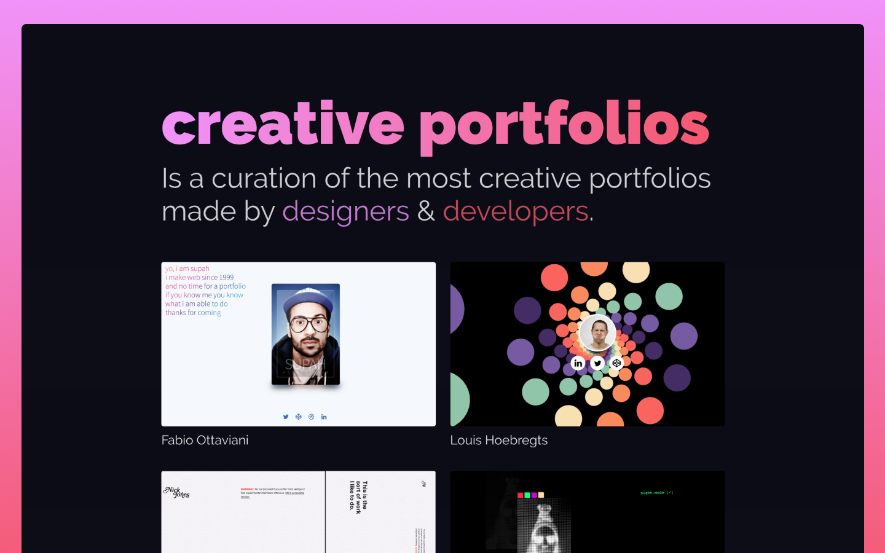

# Creative Portfolios 🌀
> This project was created with [React](https://reactjs.org/), [Gatsby](https://www.gatsbyjs.org/) and [GraphQL](https://graphql.org/).
- Contributions are more than welcome. Please see [contribution guide](contributing.md).



### Portfolios ✨
- [Danny Garcia](https://danny-garcia.com/)
- [Diana Ilithya](https://www.ilithya.rocks/)
- [Bruno Simon](https://bruno-simon.com/)
- [hovanhoa](https://hovanhoa.net/)
- [Lynn Fisher](https://lynnandtonic.com/)
- [Rogie King](https://rog.ie/)
- [Shanteli Martin](https://shantellmartin.art/)
- [Pierre Reimertz](https://www.reimertz.co/)
- [Nick Jones](http://www.narrowdesign.com/)
- [Eli Fitch](http://eli.wtf/)
- [Fabio Ottaviani](http://www.supah.it/)
- [Julian Garnier](https://juliangarnier.com/)
- [Louis Hoebregts](https://mamboleoo.be/)

### Install ⚙️
```
npm install / yarn install
```

### Start 🏃

```
npm run develop / yarn develop
```

### Build 😷

```
npm run build / yarn build
```
